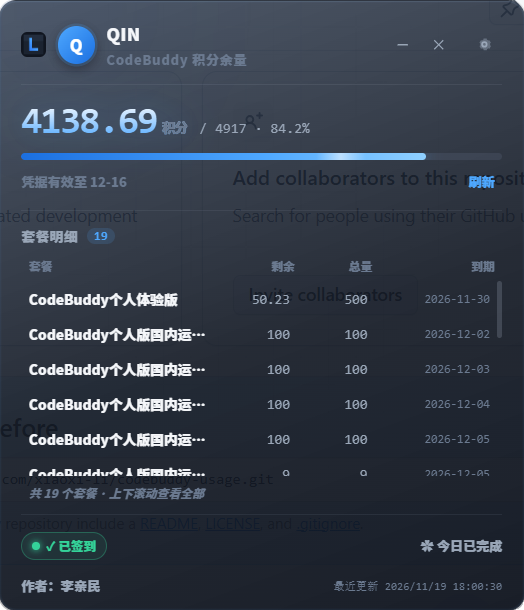

<div align="center">

# CodeBuddy Usage

**Windows 11 托盘常驻的 CodeBuddy 积分监控工具**

托盘图标直接显示积分余量，单击弹出深色玻璃质感明细卡，并自动完成每日签到与喵喵旅行领积分/派出。

[](https://go.dev/)
[](https://wails.io/)
[](#)



</div>

## 项目优势

- **绿色便携、体积极小**：单文件 `CodeBuddyUsage.exe`，解压即用，无需安装；运行时常驻内存仅约 **11~14 MB**，对系统几乎无感。
- **无需打开 WorkBuddy**：不必为了签到、领积分特意启动客户端，让本项目在后台常驻即可自动完成每日签到与喵喵旅行领积分/派出。
- **随时查看、低打扰**：积分余量直接显示在托盘图标上，需要时单击查看套餐明细；领取成功才提示，其余时间保持静默。

## 功能特性

- **托盘常驻余量**：托盘图标直接绘制积分数字（如 `4028`），无需打开窗口即可查看。
- **明细卡**：账号头像与昵称、余量/总量/占比进度条、凭据有效期、套餐明细（全部有效套餐，按到期升序，默认显示 5 条并可上下滚动查看）、签到状态、喵喵旅行倒计时。
- **自动签到**：每天自动领取签到积分，成功时托盘气泡提示。
- **喵喵旅行**：自动领取旅行积分并派出下一趟，也支持手动「领积分」「去旅行」。
- **登录态复用**：自动读取本机 CodeBuddy / VS Code 登录态（DPAPI + AES-GCM 解密），加密缓存到 `token.bin`，临近过期才重读；读取失败时可手动粘贴 Token 兜底。
- **右键菜单**：刷新 / 领积分 / 去旅行 / 设置 / 修复凭据 / 打开用量页 / 退出。
- **开机自启**：可在设置中开启。

## 快速开始

1. 运行 `CodeBuddyUsage.exe`，程序常驻系统托盘，无主窗口。
2. 单击托盘图标打开明细卡，右键打开功能菜单。
3. 首次运行会自动读取 CodeBuddy 登录态；若失败，右键选择「修复凭据」后手动粘贴 Token。
4. 在「设置」中可调整刷新间隔、自动签到、喵喵旅行、apiBase（国内/国际站）与开机自启。

> 程序为绿色便携版，配置与缓存均保存在 exe 所在目录。

## 构建

需要 Go 1.26+ 与 Wails v2 CLI。

```powershell
# 安装 Wails CLI（若未安装）
go install github.com/wailsapp/wails/v2/cmd/wails@v2.17.1

# 开发调试（热重载）
wails dev

# 生产构建，输出 build\bin\CodeBuddyUsage.exe
wails build
```

> 注意：必须使用 `wails build`（或 `go build -tags wails`）。普通 `go build` 会因缺少构建标签弹出 Wails 错误对话框并卡住。

## 配置与数据文件

以下文件位于 exe 所在目录：

| 文件 | 说明 |
| --- | --- |
| `settings.json` | 用户设置 |
| `token.bin` | DPAPI 加密的登录态缓存 |
| `app.log` | 运行日志（不含 token） |

## 实现要点

- **登录态**：读取 `%APPDATA%\<Product>\User\globalStorage\state.vscdb` 中 `ItemTable` 的 `Tencent-Cloud.coding-copilot.new.accessToken`，其 JSON `data` 数组为密文字节，需叠加 `-wal` 未回写页。
- **密钥**：从 `%APPDATA%\<Product>\Local State` 的 `os_crypt.encrypted_key` 去除 `DPAPI` 5 字节前缀，经 `CryptUnprotectData(CurrentUser)` 解出 32 字节 AES key。
- **解密**：密文 `v10` + AES-256-GCM，nonce 为第 3~15 字节，tag 为末 16 字节；正则提取 `accessToken` / `nickname` / `avatarUrl`。
- **接口**（Bearer Token 鉴权）：
  - 用量：`POST /billing/meter/get-user-resource`
  - 签到：`POST /billing/meter/checkin-status`、`/daily-checkin`（`code=10001` 视为已签到）
  - 喵喵旅行：`GET/POST /activity/growth/buddy/travel/{status,claim,depart,records}`
- **编排**：先并行签到与喵喵领积分/派出，再拉用量；claim 按「一趟旅行一次」守卫，depart 一日一次；`status.reward_credit` 恒为 0，真实到账积分从 `records` 取。
- **错误处理**：401 才判定登录失效并重试一次，403 按业务结果处理。

## 隐私说明

本项目仅在本机读取与解密用户自己的 CodeBuddy 登录态，凭据不上传任何第三方。

## 声明

非官方项目，与 CodeBuddy 官方无隶属关系。
